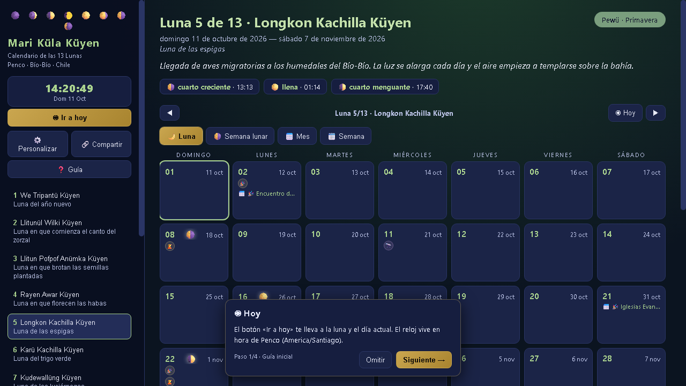
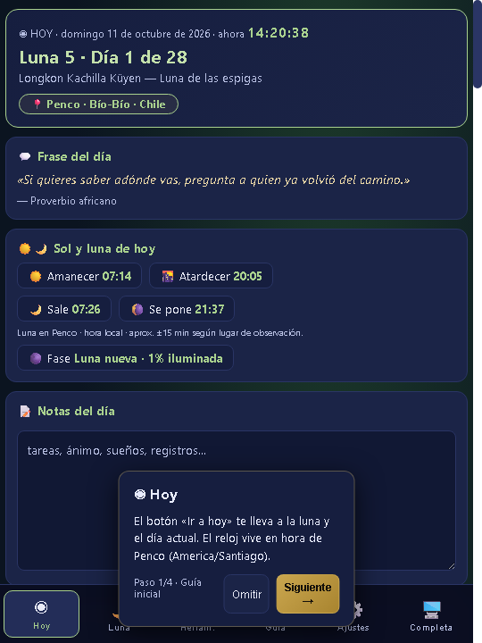

# Calendario de las 13 Lunas · Mari Küla Küyen

Calendario lunar de **13 lunas × 28 días** con cosmovisión mapuche, siembra lunar, mareas, clima y vida territorial de **Penco, Bío-Bío, Chile**. PWA offline + app de escritorio (Electron) + APK Android. 100% libre, sin publicidad ni rastreo.

🌐 Demo: **https://calendario-13-lunas.pages.dev/**




## Qué es

- **13 lunas** con nombres en mapuzugun (We Tripantü Küyen, Mawün Kürüf Küyen…), 4 estaciones (Pukem, Pewü, Walüng, Rimü) y día fuera de tiempo.
- **4 vistas:** Luna (28 días) · Semana lunar · Mes gregoriano · Semana ISO.
- **Territorio vivo:** mareas SHOA Penco-Talcahuano, clima Open-Meteo, fases lunares calculadas (`astro.js`), hora dorada, bosque nativo, huerta y siembra.
- **~80 módulos** en 7 grupos: Día, Territorio, Cuerpo, Aprender, Linaje, Hogar y Comunidad (hábitos, mapudungun, guitarra, ajedrez, huerta, botiquín, trueque, emergencias…).
- **Offline-first:** service worker (`sw.js`), datos locales en `data/territorios/penco/` con fallback embebido en `data.js`.

## Cómo correrlo (30 segundos)

**Opción 1 — Escritorio Windows (más fácil):**
doble clic en `Iniciar Calendario.bat` (usa el Electron incluido en `node_modules/`).

**Opción 2 — Web local (para celular en la misma WiFi):**
doble clic en `web/Servir Web.bat` → abre http://localhost:8137. En el celular usa la IP del PC (ej. `http://192.168.1.50:8137`).

**Opción 3 — Manual:**
```bash
npm install
npx electron .          # escritorio
node web/server.js      # web local en puerto 8137
```

## Cómo compilar

```bash
npm test                # verifica todo (sintaxis, plantillas, SW, PWA, tamaños)
npm run build:win       # .exe portable → dist-empaquetado/
npm run movil:build     # APK Android → requiere Android SDK + JAVA_HOME
npm run sync:web        # regenera la copia desplegable web/
```

APK ya compilado (v1.9.0): `dist-empaquetado/13-Lunas-offline-1.9.0.apk`. Detalle en `web/LEEME.txt`.

## Cómo adaptarlo a otra comuna

```bash
node scripts/nuevo-territorio.cjs maule "Maule"
# 1. Edita data/territorios/maule/territorio.json (nombre, coords, mareas, clima)
# 2. Ajusta especies, historia y cultivos del nuevo JSON
# 3. Abre con ?territorio=maule para probar
```

Los datos oficiales viven en `data/territorios/<id>/` (17 JSON: lunas, eventos, talleres, flora, aves, bosque, intermareal, cultivos…). Ver `scripts/validar-territorios.cjs`.

## Estructura

- `src/` — todo el código fuente (módulos `*-modulo.js`, `core-*.js`, `data.js`, `renderer.js`, CSS). Aquí se edita.
- `min/` — salida generada por `npm run build:min` (esbuild). El runtime, el service worker y los `?v=` solo apuntan aquí.
- Raíz — solo `index.html`, cargadores (`boot-modulos.js`, `sw-registro.js`), `sw.js`, `main.js`/`preload.js` (Electron) y config.
- `web/` — copia desplegable (Pages/APK), se sincroniza con `npm run sync:web -- --fix`.
- Rutas centralizadas en `scripts/paths.cjs` (los scripts y tests resuelven raíz o `src/`).

## Licencia (dual)

- **Código** (HTML/CSS/JS, Electron, APK): **GPL-3.0-o-posterior** — ver `COPYING`.
- **Contenido creativo** (textos, relatos, diseño, ilustraciones): **CC BY-NC-SA 4.0** — ver `LICENCIA-CONTENIDO-CC-BY-NC-SA-4.0.md`.

Hecho con ♥ por **Semillero Consciente** — Penco, Chile · semilleroconsciente@gmail.com
